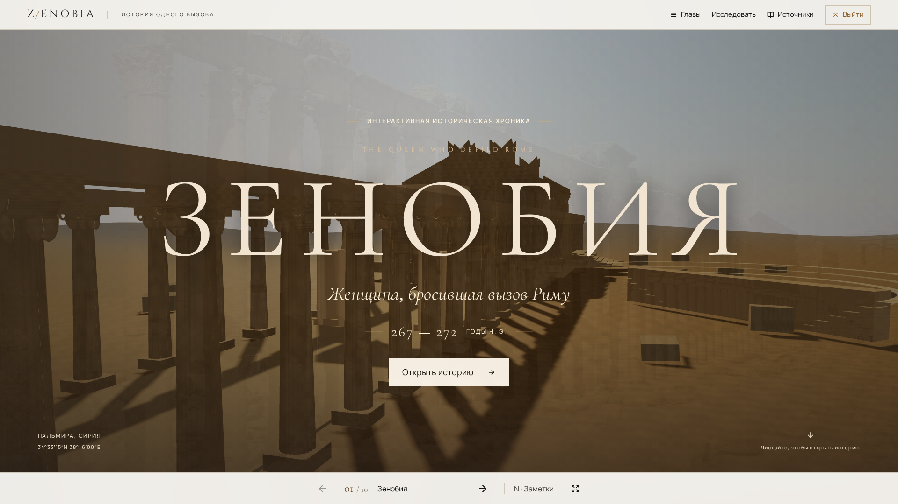
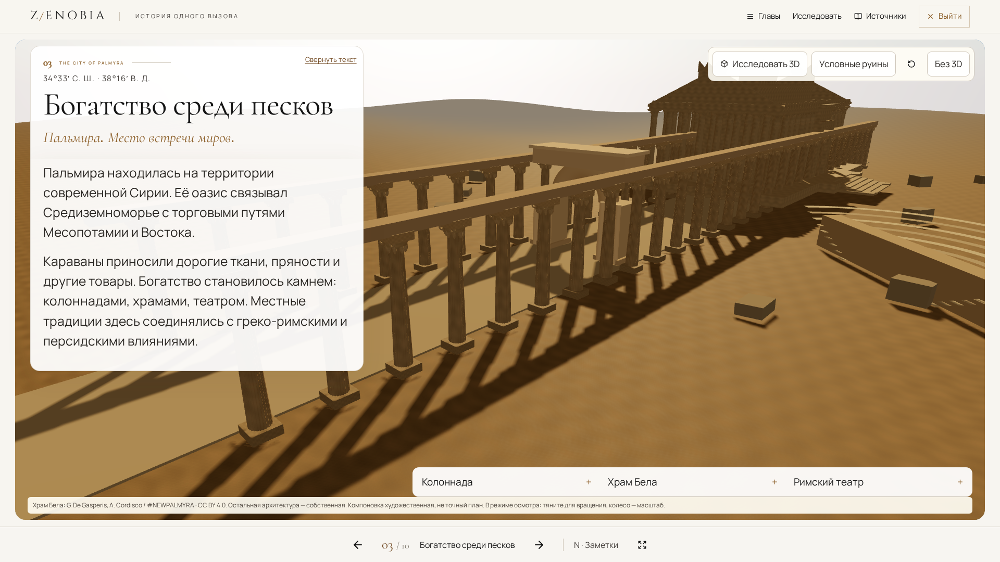
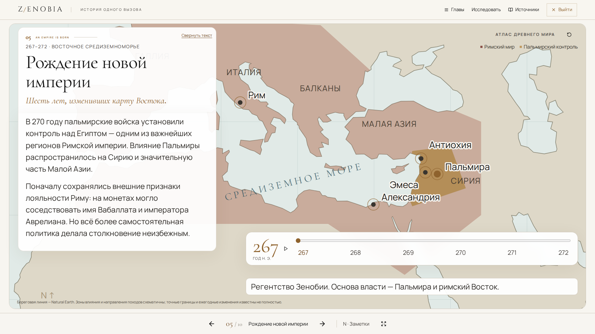
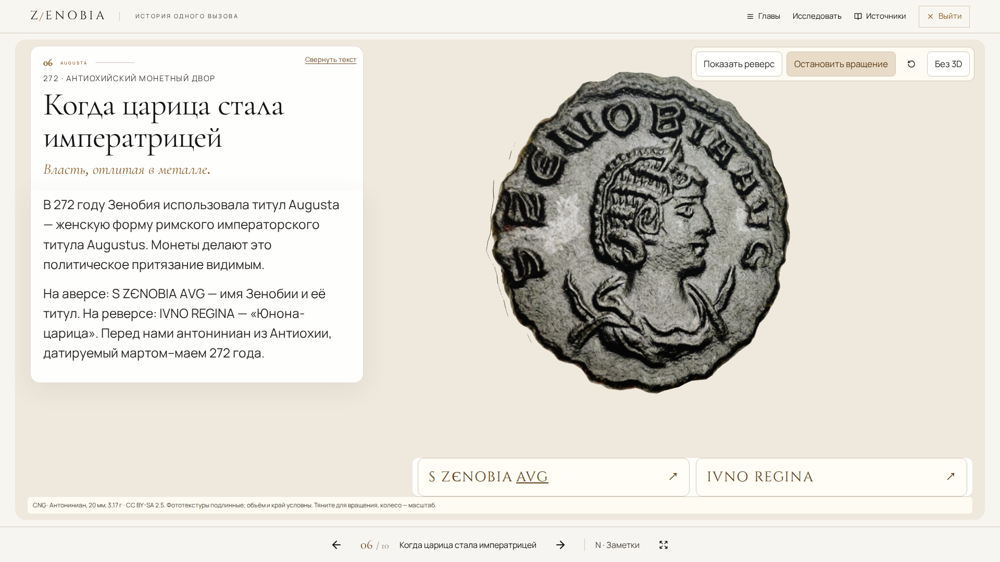
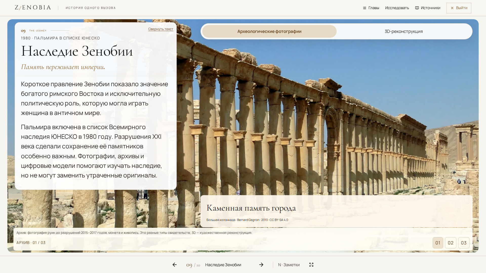

<div align="center">



<br />

# Z E N O B I A

### ЖЕНЩИНА, БРОСИВШАЯ ВЫЗОВ РИМУ

**Античная история в формате интерактивного цифрового путешествия.**  
Десять глав · 3D-Пальмира · оживающие карты · подлинные артефакты · кинематографические переходы

[**Открыть презентацию ↗**](https://xondell.github.io/zenobia-v2/) &nbsp;·&nbsp; [Источники ресурсов](ASSET_CREDITS.md) &nbsp;·&nbsp; [Запуск проекта](#запуск-локально)


</div>

---

> **267 год н. э.** Римская империя переживает кризис. На востоке, среди сирийской пустыни, возвышается Пальмира. Вскоре её правительница Зенобия подчинит себе обширные территории и бросит вызов самому Риму.
>
> Это история о власти, амбициях, войне и памяти — рассказанная **не набором слайдов, а через взаимодействие с прошлым**.

## Возможности

<table>
<tr>
<td width="50%">

**I. Древняя Пальмира в 3D**

Исследуйте античный город: вращайте камеру, приближайте храм Бела, осматривайте колоннаду, арку и театр. Исторические объекты сопровождаются пояснениями.

</td>
<td width="50%">

**II. Интерактивная карта**

Меняйте годы **267–272**, наблюдайте расширение пальмирских владений и открывайте информацию о городах прямо на карте.

</td>
</tr>
<tr>
<td>

**III. Монета Зенобии**

Объёмная монета с фотографиями подлинного артефакта. Нажатие на латинские легенды **S ZENOBIA AVG** и **IVNO REGINA** поворачивает её нужной стороной.

</td>
<td>

**IV. Режим выступления**

Полный экран, анимированные переходы, управление клавиатурой, заметки докладчика и адаптация для школьного проектора.

</td>
</tr>
</table>

## Взгляд внутрь проекта

<table>
<tr>
<td width="50%">
  
  <br /><sub><b>III</b> — Древняя Пальмира</sub>
</td>
<td width="50%">
  
  <br /><sub><b>V</b> — Расширение владений</sub>
</td>
</tr>
<tr>
<td>
  
  <br /><sub><b>VI</b> — Титул Augusta</sub>
</td>
<td>
  
  <br /><sub><b>IX</b> — Наследие Зенобии</sub>
</td>
</tr>
</table>

## Десять глав — одна история

| Глава | Сюжет |
|:---:|---|
| **01** | **Пролог** — женщина, бросившая вызов Риму |
| **02** | **Империя на грани распада** — кризис III века |
| **03** | **Пальмира** — богатство среди песков |
| **04** | **Восхождение Зенобии** — от царицы к правительнице |
| **05** | **Рождение новой империи** — завоевания и карта 267–272 годов |
| **06** | **Augusta** — императорский титул и подлинные монеты |
| **07** | **Зенобия против Аврелиана** — римское наступление |
| **08** | **Падение Пальмиры** — поражение и загадка дальнейшей судьбы |
| **09** | **Наследие** — история, искусство и памятники |
| **10** | **Эпилог** — финал и интерактивная историческая викторина |

## Управление презентацией

В режиме **«Презентация»** главы раскрываются на весь экран и переключаются с анимированными переходами.

| Клавиша | Действие |
|---|---|
| `→` / `←` | Следующая / предыдущая глава |
| `Space` | Следующий этап презентации |
| `N` | Показать / скрыть заметки выступающего |
| `F` | Полноэкранный режим |
| `Esc` | Выход или закрытие активного элемента |
| `Home` / `End` | Первая / последняя глава |

Заметки рассчитаны на выступление около **7–10 минут**. Панель заметок находится на том же экране: при показе через проектор её увидят зрители.

## Технологии

| Область | Стек |
|---|---|
| Веб-приложение | **Next.js 16**, React 19, TypeScript |
| Стили и интерфейс | Tailwind CSS 4, локальные шрифты, Lucide |
| Трёхмерная графика | **Three.js**, React Three Fiber, Drei, GLB / Meshopt |
| Анимации | **GSAP**, Web Animations API |
| Исторические карты | D3 Geo, Natural Earth, SVG |
| Тестирование | Vitest, Playwright |
| Хостинг | Static Export, GitHub Actions, GitHub Pages |

Изображения, 3D-модели, текстуры, шрифты и географические данные хранятся локально: после установки и сборки сайт можно показывать **без подключения к интернету** через локальный HTTP-сервер. Внешние исторические ссылки при этом открываться не будут.

## Запуск локально

Требуются **Node.js 22+** и **npm 10+**.

```bash
git clone https://github.com/xondell/zenobia-v2.git
cd zenobia-v2
npm ci
npm run dev
```

**Локальный адрес:** [http://localhost:3101](http://localhost:3101)

Статическая production-сборка:

```bash
npm run build
npm start
```

Сервер раздаёт папку `out/` на порту **3101**. Другой порт:

```bash
PORT=3102 npm start
```

Не открывайте `out/index.html` через `file://`: для загрузки модулей и GLB требуется HTTP.

### Проверки

```bash
npm run typecheck
npm run lint
npm test
npm run build
npm run test:e2e
```

Согласно [отчёту о разработке V2](docs/V2_REPORT.md), последняя локальная проверка включала **5/5 unit-тестов** и **27/27 браузерных тестов**. Проверены пять разрешений, управление с клавиатуры, fallback без WebGL и режим reduced motion. Физический проектор, Safari и iOS отдельно не тестировались.

## Реальная история и цифровая реконструкция

В 3D-сцене используется **храм Бела** по модели **Giovanni De Gasperis и A. Cordisco / #NEWPALMYRA**, лицензия **CC BY 4.0**. Открытая OBJ-геометрия преобразована и оптимизирована в локальный **GLB (~2,32 МБ)**.

Колоннада, арка, театр, каменные материалы, пыль, освещение и объём монеты созданы специально для ZENOBIA. Фотографии сторон монеты предоставлены **Classical Numismatic Group** и имеют собственную лицензию.

> **Границы реконструкции.** Сцена Пальмиры — художественная историческая композиция, **не точный археологический план города**. Исторические фотографии, 3D-реконструкции и поздние произведения искусства специально различаются в подписях.

**[Все авторы, источники и лицензии →](ASSET_CREDITS.md)**  
Историческая библиография также представлена внутри самой презентации, в разделе **«Источники»**.

## Публикация

Сайт собирается как статический Next.js-экспорт и публикуется через [GitHub Actions](.github/workflows/deploy.yml) на **GitHub Pages**.

```text
push → main
    ↓
GitHub Actions
    ↓
npm ci → npm run build
    ↓
  out/
    ↓
GitHub Pages
```

[**Открыть ZENOBIA ↗**](https://xondell.github.io/zenobia-v2/)

---

<div align="center">

### «Она потеряла своё государство. Но её имя осталось в истории».

<sub>ZENOBIA · Интерактивный образовательный проект на русском языке</sub>

<br /><br />

Создано **[xondell](https://github.com/xondell)**

<sub>Сторонние изображения, 3D-модели и библиотеки сохраняют собственные лицензии — <a href="ASSET_CREDITS.md">подробности</a>.</sub>

</div>
